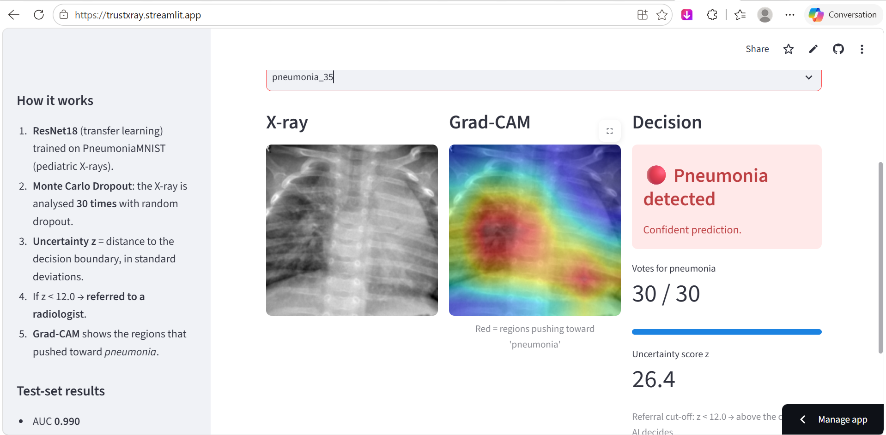
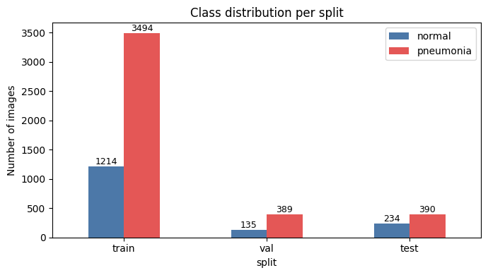
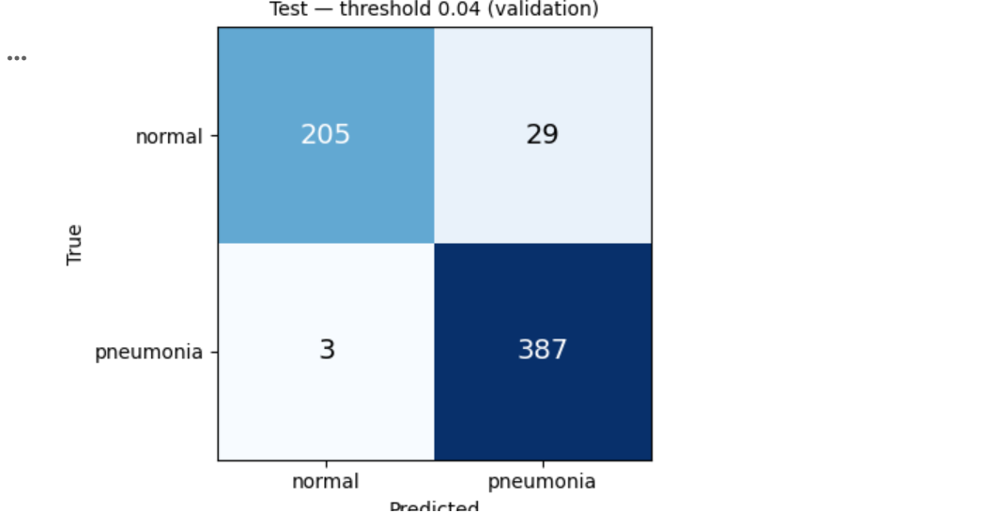
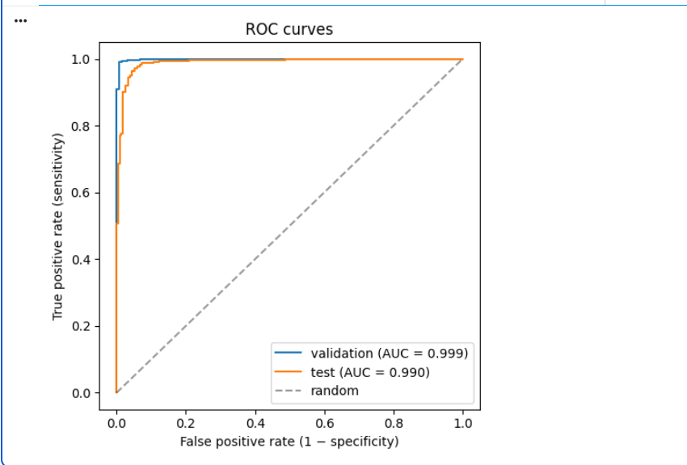
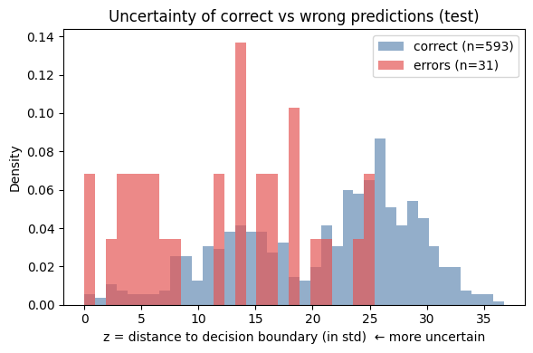
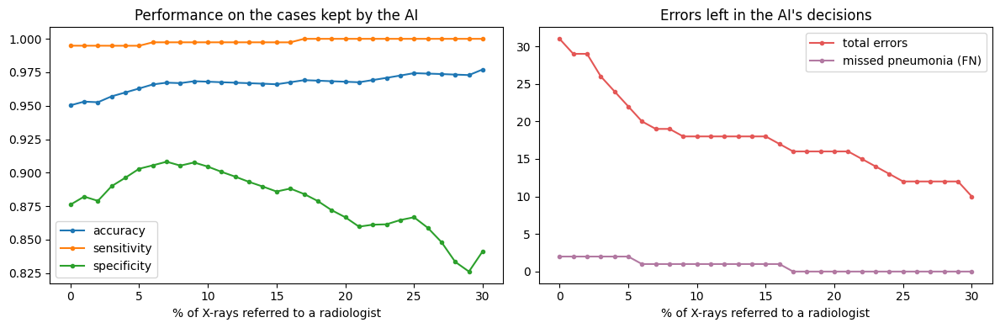
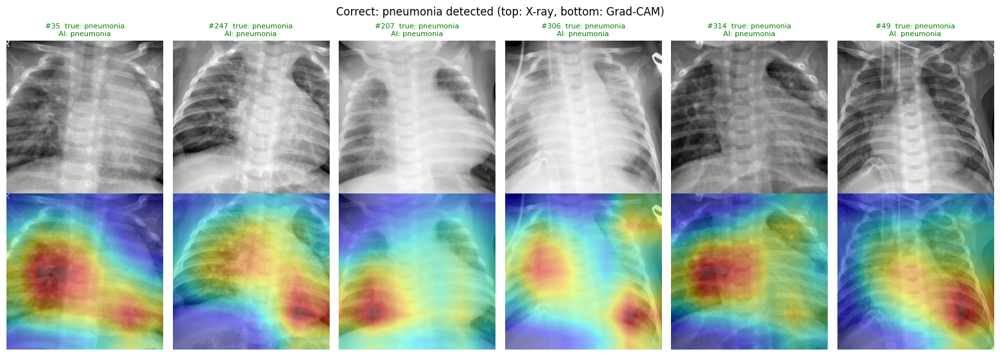
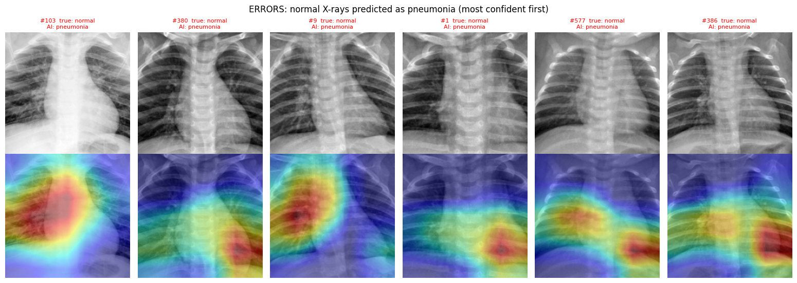

# TrustXRay — Uncertainty-aware pneumonia detection on chest X-rays

> An AI that detects pneumonia on pediatric chest X-rays, **tells how confident it is**, **shows where it looked**, and **refers uncertain cases to a radiologist**.

### 🔗 [**Try the live demo → trustxray.streamlit.app**](https://trustxray.streamlit.app/)

> ⚠️ **Research demo — not a medical device.** Not clinically validated. Do not use for diagnosis.



---

## Why this project
Most medical AI models answer with the same confidence whether they are right or wrong. A clinician cannot trust a tool that never says *"I don't know"*. TrustXRay combines:

| Component | Method | Purpose |
|---|---|---|
| Classification | ResNet18, transfer learning (ImageNet) | Detect pneumonia |
| Uncertainty | Monte Carlo Dropout (30 passes) | Know when the model is unsure |
| Referral | Uncertainty cut-off fixed on validation | Send doubtful cases to a radiologist |
| Explainability | Grad-CAM | Check that the model looks at the lungs |
| Demo | Streamlit | Let anyone test the model |

## Key results (test set, 624 X-rays never seen during training)

| | All cases | Cases kept by the AI (after referral) |
|---|---|---|
| AUC | **0.990** | — |
| Sensitivity (pneumonia detected) | 99.5% | **100%** |
| Missed pneumonia (FN) | 2 | **0** |
| False alarms (FP) | 29 | 16 |
| Accuracy | 95.0% | 96.9% |

**The uncertainty-based referral sends 16.8% of X-rays to a radiologist and catches 2 / 2 missed pneumonia cases**: on the cases it keeps, the AI sends no sick child home by mistake.

## Method and main findings

### 1. Data exploration — [`01_data_exploration.ipynb`](notebooks/01_data_exploration.ipynb)
[PneumoniaMNIST](https://medmnist.com/) (MedMNIST v2, 224×224): 5,856 pediatric chest X-rays (Kermany et al., 2018), CC BY 4.0.



- **Class imbalance** (~2.9 pneumonia : 1 normal) → class-weighted loss.
- **Distribution shift**: 74.2% pneumonia in train vs 62.5% in test → threshold tuned on validation only; evaluation with sensitivity & specificity.
- **Accuracy is misleading**: always predicting "pneumonia" already gives 62.5% on test.
- **Possible shortcut**: some images contain a laterality marker ("R") → checked later with Grad-CAM.

### 2. Baseline model — [`02_baseline_training.ipynb`](notebooks/02_baseline_training.ipynb)
ResNet18 pretrained on ImageNet, Dropout(0.3) head, class-weighted BCE loss, augmentation **without horizontal flip** (the body is not symmetric: the heart is on the left).

| Confusion matrix (threshold tuned on validation) | ROC curves |
|---|---|
|  |  |

- The tuned threshold halves missed pneumonia (7 → 3) at the cost of more false alarms (16 → 29): **choosing the operating point is a clinical decision** (screening favors sensitivity).
- Validation (AUC 0.999) is more optimistic than test (AUC 0.990): the distribution shift predicted in step 1 is confirmed.
- Probabilities are **not calibrated** (class weighting shifts them; threshold = 0.043) → the app shows votes and uncertainty, not a misleading percentage.

### 3. Uncertainty — [`03_uncertainty_mc_dropout.ipynb`](notebooks/03_uncertainty_mc_dropout.ipynb)
Each X-ray is analysed 30 times with dropout active. Uncertainty score **z** = distance between the mean logit and the decision threshold, in standard deviations.

| Errors are more uncertain | Referral curve |
|---|---|
|  |  |

- Median z: 23.0 (correct) vs 13.3 (errors); AUROC of uncertainty for detecting errors = 0.795.
- The referral rule (fixed on validation) catches **2 / 2 missed pneumonia** cases.
- Limits: the rule refers 10% of validation cases but 16.8% of test cases (distribution shift again), and some errors remain *confident* — uncertainty is a safety net, not a guarantee.

### 4. Explainability — [`04_gradcam_explainability.ipynb`](notebooks/04_gradcam_explainability.ipynb)



- On detected pneumonia, the heat falls on the **lung fields**.
- **Shortcut check**: for X-rays predicted as pneumonia, only 30.2% of the heat is in the image border (uniform map = 41%) and only 3 / 416 focus on the border → **no evidence that the model uses the "R" marker**.
- **Confident false alarms** (below): the model looks inside the lungs, on normal X-rays that look whiter / hazier → errors seem driven by image appearance (exposure, contrast), not by shortcuts.



### 5. Demo app — [`app/`](app/)
Streamlit app deployed on Streamlit Community Cloud. The trained model is published as a [GitHub release](https://github.com/Adib008/TrustXRay/releases/tag/v1.0).

## Limitations
- Pediatric patients only (1–5 years), single hospital (Guangzhou), low-resolution resized images.
- Not clinically validated, not a medical device.
- Monte Carlo Dropout is applied to the last layer only (a light approximation of Bayesian deep learning).
- Grad-CAM is coarse (7×7) and shows correlation, not causation; no lung masks were available.

## Project structure
```
notebooks/   01 exploration · 02 training · 03 uncertainty · 04 Grad-CAM
app/         Streamlit demo (app.py, config, example X-rays)
readme_figures/  figures used in this README
```

## Authors
- **Adib Ouyachchi** — data exploration, model training, uncertainty estimation (MC Dropout), Streamlit app
- **Kenza El Ouaghlidi** — Grad-CAM explainability, demo examples, model release and deployment

Both authors contributed to the analysis and the interpretation of the results.  
ESISA (École Supérieure d'Ingénierie en Sciences Appliquées), Fès, Morocco — 2026.

## References
- Kermany D. et al. *Identifying Medical Diagnoses and Treatable Diseases by Image-Based Deep Learning.* Cell, 2018.
- Yang J. et al. *MedMNIST v2: A large-scale lightweight benchmark for 2D and 3D biomedical image classification.* Scientific Data, 2023.
- He K. et al. *Deep Residual Learning for Image Recognition.* CVPR, 2016.
- Gal Y., Ghahramani Z. *Dropout as a Bayesian Approximation: Representing Model Uncertainty in Deep Learning.* ICML, 2016.
- Selvaraju R. et al. *Grad-CAM: Visual Explanations from Deep Networks via Gradient-based Localization.* ICCV, 2017.
